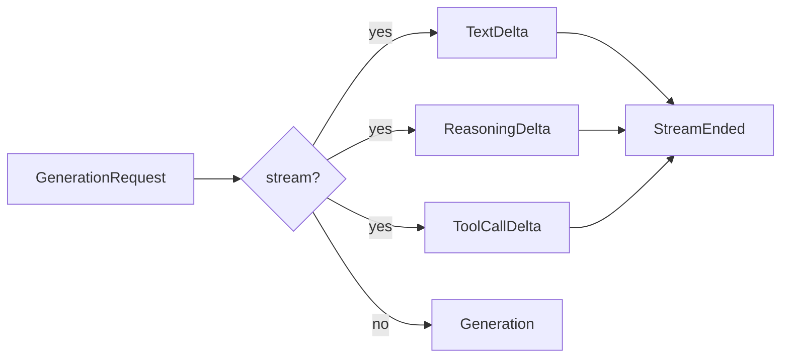

# The Event Stream

A generation **is** an ordered stream of typed events. Everything else (the non-streaming
`generate()`, the OpenAI chunk format, a progress bar) is a projection of that one
primitive. This page covers the request-scoped stream a caller consumes;
[telemetry](telemetry.md) is the separate observer-facing channel for what happened
around the request.

<div class="anyinfer-hero-diagram" markdown>

</div>

## The Events

| Event | Meaning |
|---|---|
| `TextDelta(text)` | A fragment of the visible answer. |
| `ReasoningDelta(text)` | A fragment of thinking, excluded from the answer. |
| `ToolCallDelta(index, call_id, name, arguments_fragment)` | Part of a tool call; correlate by `index`. |
| `CitationDelta(citation)` | One attribution the model reported, as soon as it arrived. |
| `ServerToolDelta(kind, status, sources, output, detail)` | A provider-run tool (such as web search) started, completed, or failed. |
| `UsageUpdate(usage)` | A usage report. May arrive mid-stream, and more than once. |
| `TimingMark(name, at_ms)` | `"attempt_start"` or `"first_token"`, measured by the core. |
| `AttemptFailed(record)` | A target attempt failed; a retry or fallback may follow. |
| `StreamEnded(result)` | Terminal. Carries the assembled `Generation`. |

## The Ordering Guarantees

These are a binding contract, verified by
[the conformance suite](../contributing/conformance.md) for every adapter:

1. Zero or more `AttemptFailed` may precede any content (failed targets, retries).
2. Within one attempt, `TimingMark("attempt_start")` comes first, and
   `TimingMark("first_token")` appears **exactly once**, immediately before the first
   content delta.
3. `StreamEnded` is always the final event, exactly once. An unrecoverable failure *raises*
   instead of yielding it.
4. Within one attempt, concatenating every `TextDelta.text` equals
   `StreamEnded.result.text`.

Guarantee 4 is what allows a consumer to render deltas as they arrive and still trust the
final result. The content deltas are `TextDelta`, `ReasoningDelta`, and `ToolCallDelta`. A
`CitationDelta` or `ServerToolDelta` is not one and does not start the first-token clock,
because a citation or a provider-run search is not a token the model produced; one can
therefore arrive before `TimingMark("first_token")`.

Guarantees 2 and 4 are scoped **per attempt**: when a schema violation triggers the
opt-in [repair loop](structured-output.md#repair), the repair re-runs the target inside
the same stream, announced by a
fresh `TimingMark("attempt_start")`. Treat each `attempt_start` as "clear and start
over": after it, the delta sequence restarts and `result.text` reflects the final attempt only.

## Consuming It

Print deltas as they arrive:

```python
with client.stream(messages, target="ollama:qwen3:8b") as stream:
    for event in stream:
        if isinstance(event, ai.TextDelta):
            print(event.text, end="", flush=True)
```

Or watch for specific events, then take the authoritative result:

```python
async with client.stream(messages, target=target) as stream:
    async for event in stream:
        if isinstance(event, ai.TimingMark) and event.name == "first_token":
            record_ttft(event.at_ms)
    record(stream.result.usage, stream.result.timing)
```

Plain `generate()` is the same machinery with the stream drained internally; ignoring
events costs nothing and changes nothing.

## Non-Streaming Providers Still Stream

An adapter for a provider with no streaming API emits one `TextDelta` and a final event.
Consumer code does not change, which is the point. The contract is the library's, not
the provider's.

## Usage Is a Late-Arriving, Optional Event

Usage often arrives *after* the finish reason, in a trailing chunk. Two consequences:

- The parser drains to the protocol's terminal sentinel, never stopping at
  `finish_reason`; stopping early undercounts tokens.
- Providers that report usage only on their terminal object
  ([Ollama](../providers/ollama.md)) still produce a `UsageUpdate` event, because the
  core synthesizes one. Consumers see one behavior.

## Finish Reasons Are an Open Enum

`FinishReason` is `"stop" | "length" | "tool_calls" | "content_filter" | "other"`. A value a
provider invents tomorrow normalizes to `"other"` rather than crashing the reassembler.
The C# SDK differs here; see [below](#in-the-c-sdk).

## Timing Is Measured by the Core

`first_token_ms`, `total_ms`, and `output_tokens_per_s` are measured centrally against a
monotonic clock, so they mean the same thing across every provider and are comparable.
Throughput is measured over the *decode* window (first token → completion), because
including queue and prefill time would understate a model's generation rate.

Provider-reported sub-timings, when available, land in `timing.phases`:

```python
result.timing.phases  # {"model_load_ms": 300.0, "prefill_ms": 200.0, "decode_ms": 1000.0}
```

## Early Exit Cancels

Leaving a stream's context manager before draining it cancels the underlying request:

```python
with client.stream(prompt, target=target) as stream:
    for event in stream:
        if enough(event):
            break  # the provider request is cancelled here
```

## In the C# SDK {#in-the-c-sdk}

The C# SDK has the same event records, deriving from
[`StreamEvent`](/csharp/api/anyinfer.streamevent/) with PascalCase properties, and the same
ordering guarantees. [`AsyncClient.StreamAsync`](/csharp/api/anyinfer.asyncclient/) returns an
[`AsyncStream`](/csharp/api/anyinfer.asyncstream/) that starts the generation on first
enumeration; disposing it (`await using`) cancels a generation still running. The
synchronous `Client.Stream` returns a [`SyncStream`](/csharp/api/anyinfer.syncstream/) that
starts the generation as soon as it is created and buffers up to 256 events ahead of the
consumer; dispose it to cancel. `Collect`/`CollectAsync` drain a stream and return the
`Generation`. The built-in C# OpenAI-compatible adapter, which also serves the Cerebras,
Hyperbolic, and Nscale presets, never emits `ReasoningDelta`, `CitationDelta`, or
`ServerToolDelta`; those come only from an application-owned adapter, such as one
registered through `AsyncClient.FromAdapters` or a custom provider descriptor.

`Generation.FinishReason` is a string, not a normalized enum: the built-in OpenAI-compatible
adapter reports the provider's own value (`stop` when the provider sent none), and the core
reports `tool_calls` when the model stopped to call tools. An unrecognized value is not
rewritten to `other`, so compare against the values you handle. Ollama's synthesized usage
event above is Python-only, because the C# SDK has no Ollama adapter.

!!! tip "Key Takeaways"
    - A generation is one ordered stream of typed events; `generate()` is just the drained
      stream, not a separate code path.
    - Four ordering guarantees are enforced for every adapter by the conformance suite:
      concatenated `TextDelta`s always equal the final text.
    - Usage and timing are measured centrally, so they mean the same thing across providers.

## See Also

<div class="anyinfer-see-also" markdown>

- [Routing and rate limits](routing.md): where `AttemptFailed` comes from.
- [Telemetry](telemetry.md): the separate, observer-facing event channel.
- [Stream typed events](../guides/streaming.md): the task-oriented walkthrough.
- [OpenAI-compatible sidecar](../serve/README.md): the OpenAI chunk projection.

</div>
