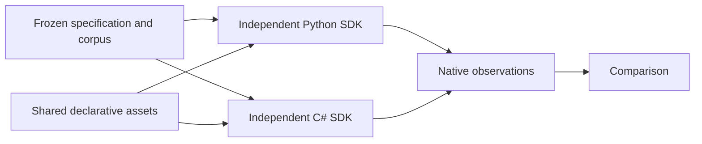

# Shared Foundation, Independent SDKs

AnyInfer defines shared language-neutral behavior contracts and declarative data while each
SDK executes natively. Conformance drivers use the frozen specification and corpus to check
those implementations; ordinary SDK calls do not read the corpus. Shared assets supply
catalog, model, and pricing data.

Python is the supported published SDK. Its CLI and OpenAI-compatible sidecar use the same
engine. The native .NET 8 C# SDK is in development as a prerelease local package
`0.1.0-proof`; it is not published to NuGet and makes no full-parity or support-matrix claim.
The `core-generation-v0` profile remains narrow. Later paired SDK behavior in accounting,
policy, retrieval, rich inputs, and tools does not expand the sealed profile or establish
release support. Read the [specification](https://github.com/anthturner/AnyInfer/tree/main/specification),
[maintenance procedure](https://github.com/anthturner/AnyInfer/blob/main/specification/MAINTENANCE.md),
and [implementation registry](https://github.com/anthturner/AnyInfer/blob/main/maintenance/implementations.json).

## C# capability map

C# currently provides synchronous and asynchronous generation, modern JSON Schema
validation, catalog and capability queries, configuration and credentials, typed telemetry
and manifests, explicit bounded accounting helpers and caller-owned policies, rich generation
inputs, and `AsyncClient.RunToolsAsync` / `Client.RunTools`. Its built-in descriptors cover
OpenAI-compatible, Cerebras, Hyperbolic, and Nscale generation, plus TEI, Voyage, and Jina
embedding and reranking (seven descriptors, ten operation bindings).

Catalog, model, and pricing data originate in Python-owned files and are embedded in the C#
assembly. Generated inert preset tables are checked in and maintained through the repository's
provider-binding maintenance scripts. C# has no runtime Python dependency. Both SDKs share the
frozen contracts and declarative data while keeping native execution and APIs independent.

C# does not provide context reduction, history reduction, local runtime lifecycle, sessions,
arena runs, evaluation, benchmarks, batch jobs, MCP, OpenTelemetry, keyring integration, or
the Python SDK's full provider breadth. A `credential://` reference is accepted when
configuration loads but always fails to resolve. Ordinary message history is part of requests;
history reduction is the absent feature. Retrieval input batching is implemented and is
distinct from batch inference jobs. Native schema and TLS limits are documented in the
[C# reference](../reference/csharp-sdk.md).
Offline hosted-provider fixtures show adapter behavior against scripted responses, not live
provider verification. See the [provider guide](../providers/retrieval.md) and
[TEI guide](../providers/tei.md) for the current retrieval evidence.

## Read next

- [Python SDK guide](../guides/python-sdk.md) and [Python API reference](../reference/api/README.md)
- [C# SDK guide](../guides/csharp-sdk.md), [migration guide](../guides/python-to-csharp.md),
  [C# reference](../reference/csharp-sdk.md), and the generated [C# API reference](/csharp/api/)
- [Architecture](../contributing/architecture.md) and [C# development workflow](../contributing/csharp-proof.md)
