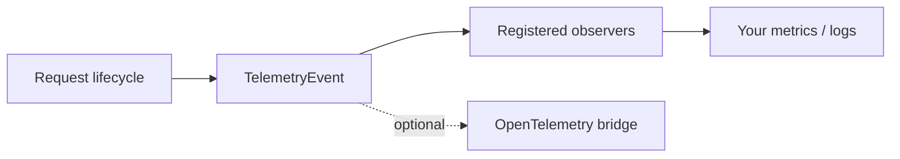

# Telemetry and Observers

The telemetry contract is **typed in-process events delivered to registered observers**.
OpenTelemetry is an optional bridge over that contract, not the contract itself.

Nothing is written anywhere by default. A deployment that wants zero telemetry pays nothing,
including no dependency.

<div class="anyinfer-hero-diagram" markdown>

</div>

## Subscribing

```python
class Recorder:
    def on_event(self, event: ai.TelemetryEvent) -> None:
        match event:
            case ai.FirstToken(at_ms=ms):
                metrics.ttft.observe(ms)
            case ai.RequestCompleted(usage=usage, timing=timing):
                metrics.tokens.inc(usage.output_tokens or 0)
            case ai.RequestFailed(error=error):
                log.warning("request failed: %s", error.detail)


client = ai.Client(providers, observers=[Recorder()])
# or later:
client.subscribe(Recorder())
```

Observers are synchronous and dispatched inline, so keep `on_event` fast; queue anything
slow. An observer that raises is isolated: the exception is swallowed and warned about once,
because a broken telemetry sink must never fail a generation.

## The Events

**Request lifecycle:** `RequestStarted` · `TargetResolved` · `AttemptStarted` · `FirstToken`
· `AttemptCompleted` · `RetryScheduled` · `FallbackTriggered` · `RepairAttempted` ·
`RequestCompleted` · `RequestFailed`

**Degradation**: the ones that make silent failures visible:

| Event | Emitted when |
|---|---|
| `ParameterDropped` | A provider accepts a parameter and discards it, or honors it only in part. |
| `UsageEstimated` | The pre-dispatch context gate estimated the request's input tokens. It is emitted on every attempt while the gate is on, so it marks an estimate even when the provider later reports usage. |
| `ProviderDiagnostic` | A provider reported something about its own runtime. |

Anything AnyInfer drops or estimates is observable; a degraded request always leaves
evidence.

`ProviderDiagnostic` covers the case the other two cannot: the request worked, nothing was
dropped or estimated, and it still took thirty seconds because the model had spilled out of
VRAM since yesterday. See [runtime diagnostics](capabilities.md#runtime-diagnostics).

**Pacing and caching:** `RateLimitWaited` (a request held back by client-side pacing) ·
`RateLimitObserved` (the allowance a provider reported) · `CachePlanned` (how a prompt
cache was engaged)

**Context reduction:** `ContextReduced` (counts and ceilings only, never content).

**Arena runs:** `ArenaCompleted` (target count, strategy, and agreement, never answer
content).

**Credentials:** `CredentialRotated` (a rotated credential rebuilt an adapter).

**Deferred batches:** `BatchSubmitted` · `BatchCompleted`

**Local subsystem:** `ServerLifecycle` · `DownloadProgress`

## Payloads Are Off by Default

Prompt and response text are `None` unless an observer explicitly opts in:

```python
client.subscribe(audit_log, payloads=True)  # sees prompt and response text
client.subscribe(metrics)  # never does
```

Stripping happens **per observer**, so one payload-consuming sink does not leak text to the
others. Everything still passes redaction first.

## Correlating Events

Every request-lifecycle event carries a `request_id`. A fallback chain that tried three
targets emits one `RequestStarted` and one terminal event with the same id, so a trace reads
as a single request rather than three disconnected ones.

## The OpenTelemetry Bridge

```python
from anyinfer import otel

otel.install(client)  # spans and metrics, payload-free
```

The bridge is part of the Python SDK and requires the `[otel]` extra; nothing
OTel-related is imported otherwise. What the bridge
emits (one span per request, attempts as span events, GenAI semantic-convention metrics)
is covered in [the observability guide](../guides/observability.md#opentelemetry).

The bridge is one consumer of the event contract. Applications that want structured data
in-process (a JSONL trail, a SQLite evidence table) consume the events directly rather
than round-tripping through spans.

## In the C# SDK {#in-the-c-sdk}

The C# SDK has the same typed events, deriving from
[`TelemetryEvent`](/csharp/api/anyinfer.events.telemetryevent/), delivered to an
[`IObserver`](/csharp/api/anyinfer.events.iobserver/) through the client's `observers`
argument or `Subscribe(observer, payloads)`. Observers run synchronously on the emitting
thread, may be called concurrently by concurrent requests, and are isolated: an exception
is suppressed, and the first one per subscription is traced as a warning. Payload fields
are `null` unless the subscription opts in.

Seven of the event types are never emitted by the C# SDK, because it has no feature that
would produce them: `ArenaCompleted`, `ContextReduced`, `CredentialRotated`,
`BatchSubmitted`, `BatchCompleted`, `ServerLifecycle`, and `DownloadProgress`. The
`ProviderDiagnostic` it emits for an unstable prompt-cache prefix carries no request ID.

[`JsonlObserver`](/csharp/api/anyinfer.events.jsonlobserver/) appends redacted events to a
file you own. [`LoggingObserver`](/csharp/api/anyinfer.events.loggingobserver/) writes to a
.NET `TraceSource`; constructed without one, it creates an `AnyInfer.Telemetry` source
whose switch is off, so it records nothing until that source is configured or you pass
your own. There is no OpenTelemetry bridge.

!!! tip "Key Takeaways"
    - Telemetry is typed in-process events to registered observers; OpenTelemetry is an
      optional bridge, not the contract itself.
    - Prompt and response payloads are off by default, per observer, so one consumer's
      opt-in never leaks text to another.
    - Degradation is observable: `ParameterDropped` and `UsageEstimated` mean a dropped
      parameter or an estimated token count always leaves evidence.

## See Also

<div class="anyinfer-see-also" markdown>

- [The event stream](events.md): the *other* event channel, for response content.
- [Capabilities](capabilities.md): why `ParameterDropped` exists.
- [How-to: observability](../guides/observability.md)

</div>
